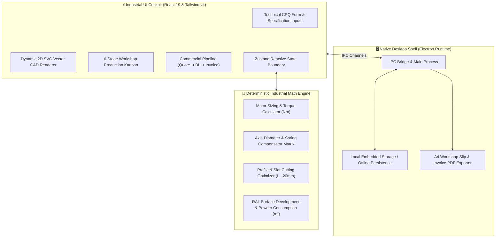

# Perfect Metal ERP — Industrial CPQ, Fabrication & Powder Coating Workshop OS

<p align="center">
  
  
  
  
  
  
</p>

---

## Executive Summary

**Perfect Metal ERP** is a mission-critical, **100% Offline-First desktop operating system** engineered specifically for industrial metal fabrication facilities specializing in automated commercial rolling shutters (*rideaux métalliques*), architectural security grilles, and industrial electrostatic powder coating ovens (*thermolaquage au four epoxy-polyester*).

Built with **React 19**, **TypeScript**, **Electron**, and **Zustand 5**, the platform replaces error-prone manual workshop spreadsheets with a deterministic engineering math engine, real-time vector CAD visualization, cutting-slip optimization, and an end-to-end commercial lifecycle from initial quote to factory-floor installation.

---

## System Architecture



---

## Core Engineering & Mathematical Pillars

### 1. Deterministic Technical CPQ (Configure, Price, Quote)
* **Millimeter-Accurate Sizing:** Slat profiles dimensioned directly via clear opening parameters ($W_{\text{clear}} \times H_{\text{clear}}$ in millimeters).
* **Multi-Material Slat Profiles:**
  * Galvanized steel full slats ($8/10^{\text{e}}$ & $10/10^{\text{e}}$ reinforced).
  * Micro-perforated commercial showcase ventilation profiles.
  * Cobra wave / tubular architectural grilles.
  * Polyurethane-insulated double-wall extruded aluminum.
* **Automated Physical Sizing & Motor Torque Sizing:**
  * Automated curtain surface area ($m^2$) and total curtain weight ($kg$) calculation.
  * Shaft diameter selection ($\varnothing 60, 76, 101, 133\text{ mm}$) with compensatory spring boxes.
  * Exact motor torque sizing in Newton-meters ($Nm$): central ACM Titan/Unititan motors, tubular motors, or industrial lateral gearboxes with safety parachutes.

### 2. Real-Time Dynamic 2D SVG Vector CAD Engine
* Renders an interactive, vector-accurate preview of the shutter assembly on-the-fly.
* Accurately depicts real proportions, individual slats, side guides (*coulisses*), roll-up barrel, top box, bottom reinforced slat, and real-time RAL powder color rendering.

### 3. Electrostatic Powder Coating & RAL Colorimetry
* Interactive RAL palette with real-time visual color mapping (RAL 7016 Anthracite, RAL 9005 Jet Black, RAL 9010 Pure White, RAL 8014 Sepia Brown, etc.).
* Dynamic finish calculations: Textured sandblasted, matte, high-gloss, and satin.
* Automated computation of total developed surface area to be coated ($m^2$) and raw powder cost per oven cycle (200°C curing).

### 4. Workshop Cutting Optimization & A4 Factory Slips
* **A4 Workshop Cutting Slip (*Fiche de Débit*)**: Generates operator cutting instructions specifying exact cutting dimensions for slats ($L - 20\text{ mm}$ clearance), guide rails, and winding shaft.
* **6-Stage Production Kanban**:
  1. *Quote / Engineering Validation* ➔ 2. *Cutting & Debiting* ➔ 3. *Powder Coating Oven (200°C)* ➔ 4. *Shaft & Slat Assembly* ➔ 5. *Motor & QC Testing* ➔ 6. *Delivered & Installed*.

### 5. Full Commercial Accounting Lifecycle
* Seamless financial flow: **Commercial Quote (*Devis*)** $\to$ **Purchase Order** $\to$ **Delivery Note (*Bon de Livraison*)** $\to$ **Final Tax Invoice**.
* Down payment and deposit tracking (e.g. 50% mobilization advance).
* Real-time outstanding balance and account receivables monitoring.
* Print-ready A4 document generation with high-res corporate branding.

### 6. Raw Material Inventory Management
* Real-time tracking of steel coils, extruded slat bundles, guide bars, ACM motors, and RAL powder stock in kg.
* Automatic visual low-stock alerts triggering when materials fall below threshold reserves.

---

## Industrial UI/UX Design Compliance

In compliance with mission-critical factory floor requirements:
- **Zero Default Browser UI:** 100% custom-styled selects, numeric inputs, and date pickers. Native OS dropdowns and spinners are completely stripped.
- **Physical Feedback & Affordance:** Explicit pointer cursors on all interactive controls (`button`, `a`, select triggers, calendar cells).
- **Industrial Visual Palette:** Dark room theme (`#07090E`), precision electric cyan (`#0284C7`), chrome metallic accents, and high-contrast tabular typography for numerical readings.
- **Offline Resilience:** All mutations commit locally with zero dependency on internet connectivity or external APIs.

---

## Project Structure

```text
perfect-metal/
├── electron/                    # Electron main process, IPC handlers, native window setup
│   ├── main.ts                  # Application lifecycle and IPC bridges
│   └── preload.ts               # Context isolation and secure IPC allowlists
│
├── src/
│   ├── components/              # Modular industrial components
│   │   ├── cpq/                 # Slat selector, dimension inputs, RAL color picker
│   │   ├── cad/                 # 2D dynamic vector SVG shutter renderer
│   │   ├── kanban/              # 6-stage workshop production board
│   │   ├── billing/             # Quotes, orders, delivery slips, invoices
│   │   └── inventory/           # Raw materials & motor inventory tables
│   │
│   ├── store/                   # Centralized reactive state (Zustand 5)
│   ├── utils/                   # Motor torque sizing, cutting math, RAL colorimetry
│   ├── App.tsx                  # Root layout & view router
│   └── main.tsx                 # React 19 bootstrap
│
├── public/                      # Static brand assets & logo
├── vite.config.ts               # Vite + React 19 + Tailwind CSS v4 compiler config
└── package.json                 # Project dependencies & build scripts
```

---

## Quickstart & Installation

### Prerequisites
* **Node.js** >= 18.0.0
* **npm** >= 9.0.0

### 1. Installation
```bash
git clone https://github.com/Lpiks/perfect-metal.git
cd perfect-metal
npm install
```

### 2. Development Mode

#### Run Desktop Application (Electron + Vite)
```bash
npm run dev
# or
npm run desktop:dev
```

#### Run Web Development Server
```bash
npm run web
# Launches instant preview at http://127.0.0.1:5174
```

### 3. Production Build
```bash
npm run build
```

---

## Author & Engineering Credits

Architected and developed by **Abdelhadi Hammaz** ([@Lpiks](https://github.com/Lpiks))  
*Senior Full-Stack & Systems Engineer • Co-founder, Stepping Stones Agency*

Distributed under the **ISC License**.
